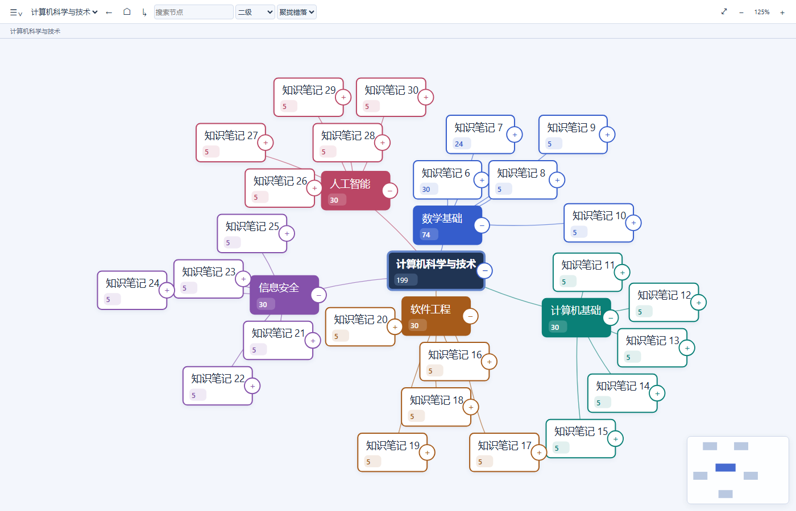

# MindTree 0.9.2

Obsidian 文件夹组织导图插件：将已有笔记系列映射为可搜索、可聚焦的导图。KnowledgeTree 是独立知识工作区；MindTree 使用 Obsidian 的 Vault、Markdown 与宿主设置。

[下载 0.9.2](https://github.com/snowfeeling3/MindTree/releases/tag/0.9.2) · [更新记录](CHANGELOG.md) · [验证与限制](docs/RELEASE_VALIDATION.md)

### 安装、启停与数据

要求 Obsidian ≥ 1.8.7；这是声明的最低 API 版本，真实宿主和移动端兼容性仍待验收。将 Release 的 `main.js`、`manifest.json`、`styles.css`、`THIRD-PARTY-NOTICES.md` 解压至测试 Vault 的 `.obsidian/plugins/mindtree/`，重启后在社区插件中启用。命令面板运行 Open MindTree，设置中添加学科文件夹，再更新索引。

先在 Vault 副本试用并备份。禁用插件会注销监听与界面，不删除笔记；卸载不会自动清除写入 Markdown 的索引或 frontmatter。移除插件文件夹会丢失其中 `data.json` 的显示与学科配置，先备份它。损坏配置会阻止加载并提示备份修复，不会在加载迁移时覆盖原文件。

### 开发

Node.js 22；`npm ci`、`npm test`、`npm run build`。浏览器回归：`npx playwright install chromium`，`npm run test:browser`。`npm run stage` 只写隔离 test-vault，不操作个人 Vault。

一个节点，一篇 Markdown。One node, one Markdown file.

当前主入口：选择现有学习系列文件夹 → 一键生成各级介绍索引 → 展示整个系列的目录组织导图。Existing subject folder → generate folder introductions → visualize the entire series organization.

已有笔记不覆盖，自动目录之外的手写内容保留。New series use folder hierarchy; old manual series remain readable. No existing notes are overwritten.

开发 / Development: 在本目录执行 `npm ci`、`npm test`、`npm run build`、`npm run stage`。The staging command targets only test-vault. Distribute main.js, manifest.json and styles.css.

[使用指南 / User guide](docs/user-guide.md) · [验证 / Verification](docs/verification.md) · [架构 / Architecture](docs/architecture.md) · [数据模型 / Data model](docs/data-model.md) · [研究 / Research](docs/research.md)

57 项自动测试与构建通过；尚未完成真实 Obsidian 宿主验收。57 automated tests pass; actual host acceptance remains pending. Do not interpret mocked API tests as host verification.

主界面：紧凑菜单栏 + 学科快速选择 + 完整画布。配置在 Obsidian 插件设置；提供右向树、纵向树和双向分支。Compact native-style toolbar, subject switcher and full canvas; settings are separate.

0.9.0：全局放射、局部树、知识聚焦，摘要集合、语义缩放、面包屑、搜索、历史、全局缩略图与可取消相机动画。[方案与组件数据流](docs/adaptive-layout.md)。Chromium 已验证 50/200/1000 节点交互；Obsidian 宿主验收仍待完成。

0.9.0 restores double-click/Enter to open the original note. Shift+double-click/Shift+Enter focuses a subtree. 双击/Enter 打开原笔记，Shift+双击/Shift+Enter 聚焦分支。

0.9.0: global depth 1/2/3/custom/all, recursive staggered radial branches, exact numeric counts, zoomable full overview. Folder-index identity follows metadata, not filename.

0.9.0: recursive subtree entry with matching depth/layout controls, working expansion past depth limits, compact variable-width tree and local-only radial collision avoidance.

[算法研究与基准对比 / Algorithm study and benchmark](docs/layout-algorithm-study.md). `npm run benchmark:layout` reproduces the tree comparison. Runtime dependency notices accompany plugin distributions.

[连线路由方案与比较 / Connector routing](docs/connector-routing.md). `npm run benchmark:routing` reproduces same-position path comparisons. Smart connectors and original curves are selectable from the menu.

0.9.0: compact staggered subtree clusters, high-contrast framed cards, branch colors and corrected initial viewport fitting. [Layout and visual evidence](docs/compact-clusters.md).

0.9.1：点击节点 **+** 时，以该节点为局部根居中展开；继续展开下级，视角逐级跟随，不再用全学科的扇区和边界取景。Esc 返回原观察位置，⌂ 回到全局；全局缩略图保留全部一级分支。双击仍打开原笔记。

Click **+** to expand around that node as the local root. Further expansion follows the clicked branch instead of refitting the whole subject. Esc restores the prior observation; ⌂ returns to the global overview. Double-click still opens the original note. [Implementation and checks / 实现与验证](docs/expansion-focus.md).

## License

[MIT](LICENSE)。依赖许可见 [THIRD-PARTY-NOTICES.md](THIRD-PARTY-NOTICES.md)。
